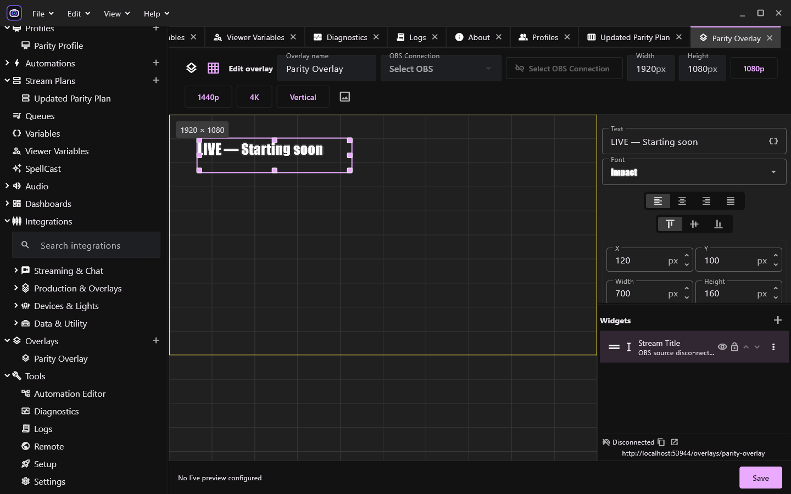

<p align="center">
  
</p>

<h1 align="center">ShowRunner</h1>

A production workspace for streamers and live creators, built with Flutter for Windows.

[Download releases](https://github.com/saitatter/sai-showrunner/releases) ?
[Changelog](CHANGELOG.md) ? [Documentation](docs/README.md)

## Prepare and run your show

- Build visual automations with typed connections, conditions, variables,
  reusable subgraphs, queues and execution feedback.
- Connect Twitch, YouTube and OBS; manage chat, events, scenes and production tools.
- On the development branch, use [managed commands and unified chat](docs/chat-and-commands.md)
  with Twitch/YouTube, cooldowns, role checks and a local OBS chat dock.
- Organize broadcasts with profiles and segmented Stream Plans.
- Design OBS browser overlays with editable widgets and visual Shader Graph effects.
- Route sound and TTS, use viewer data, and control remote dashboards.
- Connect Bluetooth heart-rate sensors and supported lighting/device integrations.



ShowRunner is based on [CastMate](https://github.com/LordTocs/CastMate), with its own
Flutter desktop runtime and release process. Attribution and license notices remain.
OBS overlays use a separate browser renderer because OBS consumes Browser Sources.
Copy the Browser Source URL from the overlay editor, including its fragment.
Existing OBS sources using an older URL need that URL refreshed with the editor's
source helper. Overlay capabilities are independent of the chat dock token.
The automation and shader editors use [sai_nodes](https://github.com/saitatter/sai_nodes).

The Flutter desktop shipped in **v2.0.0**. New development features remain under
**Unreleased** until publication. Supported features,
external-service limits and missing integrations are documented in
[product status](docs/product-parity.md) and the
[Streamer.bot comparison](docs/streamerbot-comparison.md).

## Build and contribute

Use Flutter **3.47.7**, Dart **3.13.5**, Node.js **22**, and the repository's Yarn **4.1.0**.
Windows desktop builds also require Visual Studio's Desktop development with C++
and the Windows SDK. Keep dependency lockfiles intact.

```powershell
node .yarn/releases/yarn-4.1.0.cjs install --immutable
node .yarn/releases/yarn-4.1.0.cjs overlay:build
Push-Location packages/showrunner-flutter
flutter pub get --enforce-lockfile
flutter run -d windows
Pop-Location
```

Run the same local checks used by CI:

```powershell
./scripts/ci-check.ps1
# Native lifecycle and screenshot checks when relevant:
./scripts/ci-check.ps1 -Integration -Visual
```

See [AGENTS.md](AGENTS.md), [architecture](docs/architecture.md),
[testing](docs/testing.md) and [release policy](docs/versioning-policy.md).
For integrations, follow the [first-party plugin layout](packages/showrunner-flutter/lib/plugins/README.md)
and its module lifecycle, connection ownership and event-delivery contracts.
Releases are manual from main, with a preview, curated changelog notes and unsigned
Windows ZIP packages. No signing certificate is required. Merging a PR does not
publish or change the version.

## Repository layout

| Path | Purpose |
| --- | --- |
| `packages/showrunner-flutter` | Desktop application, graph runtime, persistence and Dart plugins |
| `packages/showrunner-obs-overlay` | OBS browser source |
| `libs/showrunner-schema`, `libs/showrunner-overlay-*` | Browser contracts, widget loading and rendering/build support |
| `plugins/*/overlay`, `plugins/*/shared` | Maintained browser widgets and shared protocol types |
| `scripts`, `tools` | Verification, packaging and release tooling |
| `test/reference` | Frozen comparison fixtures and Flutter regression baselines |

Licensed under [AGPL-3.0](LICENSE.md). See [dependency provenance](docs/dependency-provenance.md)
for upstream package and font notices.
