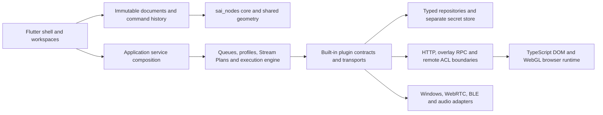

# Architecture

## Runtime boundaries

The Windows desktop is a Flutter/Dart application. The production browser overlay
is TypeScript/DOM/WebGL; OBS loads it as a Browser Source. Removing this package
would remove overlay functionality, not complete a desktop migration.

`sai_nodes_core` owns immutable graph entities, definitions, resolution and geometry.
`sai_nodes` provides the Flutter canvas. ShowRunner supplies domain definitions,
resource adapters, compiler/runtime behavior and editor UI. Both dependencies are
pinned to the published 1.0.0 packages in pubspec.yaml and pubspec.lock.

## Authoring and execution

AutomationDocument uses its current `schemaVersion: 1` host envelope and embeds the
canonical graph document, settings and metadata. The graph is the only authoring
source. Do not confuse this with the retired V2 schema; old formats are rejected.
Unsupported Stream Plan/automation documents remain inspectable as errors and cannot
be silently saved over. There are no old-format decoders or compatibility aliases.

All authoring changes use graph commands and transactional undo/redo. Clipboard
operations preserve transitive subgraph dependencies and remap semantic references.
Runtime traces, selected execution sessions and compiled projections are ephemeral;
they must not dirty saved graphs. Runtime entity IDs match authoring IDs.

GraphExecutionEngine is the execution boundary used by queues, profiles, Stream
Plans, plugin events and node runs. The production compiled engine uses a cached
flat program and Dart VM. The interpreter is retained as a correctness oracle.
Cancellation, guards and failures are propagated through actions and subgraphs.

Shader authoring uses the same immutable graph/core/canvas. Semantic changes
invalidate generated GLSL; presentation changes do not. Node previews use derived
documents. Shader source is compiled/rendered by the actual browser WebGL runtime.

## Plugins, persistence and remote control

Built-in Dart plugins own manifests, action/trigger contracts, runtimes and UI
contributions; see the [plugin layout](../packages/showrunner-flutter/lib/plugins/README.md).
Configured transports and event workers are composed in configured_plugin_registrar.
An unconfigured provider is not evidence of a successful external connection.

User data uses typed resource repositories, atomic writes and explicit validation.
Viewer data and secret settings have separate persistence boundaries. Tests use
isolated directories and must never seed or reset production storage.

Remote/Satellite dashboards exchange versioned resource, state and button messages.
They are not a mechanism to load desktop plugins into another process. The current
registered dashboard widgets are label and remote button; unknown kinds remain
visible placeholders. External plugin loading is intentionally deferred in ADR-003.

## Verification boundaries

Frozen Electron contracts/screenshots provide historical comparison evidence, not
a second maintained application. Contract inventory and screenshot differences are
separate measurements. A green contract/catalog job is not a pixel-parity claim.
See [testing](testing.md) and [product status](product-parity.md).

## Dependency and lifecycle ownership

| Owner | Creates/starts | Releases | Stable boundary and constraints |
| --- | --- | --- | --- |
| Application service composition | Shared event hub, stores, command manager, registry and runtime workers | Application shutdown/lifecycle coordinator | Observable runtime state is separate from authoring documents |
| Workspace/document sessions | One editor controller and history per opened document | Tab close after dirty guard | `WorkspaceId`, `AutomationDocument`, commands/history and shared scene geometry |
| Graph runtime and queues | Compiled projections, cancellation and execution sessions | Completion, cancellation or queue shutdown | `GraphExecutionEngine` and `ExecutionTraceSource`; interpreter remains an oracle |
| Plugin registry | Initializes once, starts modules in registration order | Stops in reverse order, continues after stop failures | `DartPluginModule`; disable gates contracts and is not a worker lifecycle promise |
| Persistence services | Validated resource and state operations | Serialized atomic writes and explicit caller lifetime | `ResourceRepository`; unsupported documents cannot be overwritten |
| Overlay and HTTP bridge | Request handlers, socket peers, event/state subscriptions | Bridge disposal removes handlers/listeners and closes peers | Browser protocol is versioned independently of Flutter UI |
| Chat dock | Loopback listener and a distinct stored random capability | Service stop; disable controls restoration | Chat-only principal, separate from overlay or remote permissions |
| Remote dashboards and device adapters | Signaling, WebRTC channels, BLE subscriptions, playback | Owning module/connection stop and cancellation | Native integration must stay behind injectable transport boundaries |

These types are integration seams, not an ABI guarantee for third-party code.
External plugins remain isolated and versioned under [ADR-003](architecture/adr-003-external-plugins.md).
No in-process loader, Electron/Vue revival, Timeline editor or silent migration is
part of this baseline. Arbitrary docking requires [ADR-004](architecture/adr-004-workspace-docking.md).

## Network trust review

The baseline phase is in progress. Bindings and ACLs below are source-reviewed;
only the explicit reproducers are confirmed issues. A configurable listener is
not by itself an exploit. All probes use ephemeral loopback ports and isolated
stores, never a running user service. Host/Origin validation prevents browser
cross-origin requests and rebinding-style forged authorities; it is not LAN
authentication and does not establish an end-to-end DNS-rebinding exploit.

| Surface and audience | Inputs, outputs and authorization | Limits and evidence |
| --- | --- | --- |
| Overlay HTTP, OBS same host or opted-in trusted LAN | Default `127.0.0.1:8181`; `allowRemoteAccess` binds anyIPv4. GET `/overlays/<id>`, `/config`, `/overlays/assets/*`, `/media/default/*`, `/media/tts-cache/*`. Known resource ID, public config projection and contained asset/media paths; no bearer capability today | Shared Host/Origin guard before handlers; local IPs, localhost and the machine hostname remain supported. Existing isolated fixture verifies config projection, unknown IDs and foreign-origin rejection. Junction escape protection has a Windows persistence fixture |
| Overlay WebSocket, same listener | Upgrade `/?overlay=<id>`, request/response IDs; config/widget/broadcast/audio notifications; plugin state acquisition and viewer schemas/query/events. Known overlay ID, same-origin guard; no per-overlay field/capability ACL yet | 1 MiB inbound messages, 64 pending outbound RPCs, 20-second default RPC deadline. Malformed JSON/binary/oversized frames close only their peer. Silent initial config ACK expires. Aggregate request rate, inbound concurrency, replay and viewer query/response quotas remain open |
| Dynamic profile HTTP triggers | `/plugins/endpoints/<route>` with GET/POST/PUT/PATCH/DELETE, route/query/body to active profile subscriptions. Same bind as overlay; no token. Cancellation unregisters the route | 1 MiB body, 20-second dispatch/body timeout, Host/Origin validation. Timeout is not proof of cancellation of a handler already executing |
| Remote button HTTP, explicitly enabled local integration | Disabled by default; `127.0.0.1:8390`, configurable host. GET `/buttons`; POST `/buttons/press?button=...` emits a named trigger. No bearer credential | Host/Origin guard before enumeration or action. Local native callers without Origin remain supported. Opted-in LAN access still trusts network peers; authentication, replay and rate quotas remain open |
| Chat OBS dock | Separate loopback-only port; `/api/*` requires `x-showrunner-chat`, 32 random bytes stored in secret settings. HTML URL fragment carries bootstrap capability; no query token, browser storage or shared overlay token | Exact Host/Origin, no-store/no-referrer/CSP. POST bodies limited to 8 KiB, preferences 256 KiB, stream idle deadline 10 seconds. Private messages excluded. Existing dock tests probe forged Host/Origin even with valid credential |
| OAuth callbacks | Ephemeral loopback listener; Twitch uses fixed supported callback port. Random state, YouTube authorization code with PKCE; Twitch fragment forwarded by local callback page | Five-minute callback wait. Isolated OAuth fixtures cover callback/state flow. Host/body quotas and cancellation under slow malformed clients require additional review |
| Remote/Satellite dashboards | Outbound authenticated cloud signaling plus WebRTC data channels. Shared dashboard ID and `remoteTwitchIds` ACL checked before accepting a connection; widget RPC resolves the shared dashboard | Simulated signaling/peer fixtures verify ACL and button RPC. Cloud identity attestation, peer replay, data-channel quotas and live revocation behavior still need proof; payload identity alone is not authentication evidence |
| Provider and native adapters | Outbound OBS/provider WebSockets/HTTPS, configured Minecraft/Kasa TCP; LIFX binds wildcard UDP on ephemeral ports for discovery/control; WebRTC ICE, OS BLE/audio/native window adapters | Separate device/provider principals. No general plugin loader or desktop RPC listener. Real cloud, UDP devices, ICE/BLE and audible output remain manual/opt-in |

Confirmed isolated reproducers and fixes:

- The HTTP listener accepted a matching attacker-controlled Host/Origin and invoked
  a registered handler (204). It now rejects the authority before routing (403).
- Remote buttons accepted a foreign-Origin POST and emitted its trigger (204).
  Both foreign-origin and forged-authority probes now return 403 before dispatch.
- Overlay JSON parsing raised an unhandled asynchronous exception and left the
  peer connected. The malformed-frame fixture failed before the patch; the peer
  now closes with an invalid-payload status. Additional bounds cover oversized,
  binary and unresponsive peers without changing supported RPC names or envelopes.

Open access-path observation: any peer that knows an overlay ID can request plugin
states and viewer data when it can reach the opted-in LAN listener. This follows
from `_handlePeerRequest` and `_queryViewerData`; no live user data was queried.
Do not classify it as a default internet exposure or as resolved by Origin checks.
The remaining baseline work needs an isolated unauthorized-data reproducer and a
decision on independent overlay-scoped capabilities and field projection, preserving
OBS Browser Sources and media loading. Do not reuse the chat dock token.

Secret storage tests verify persistence with an injected fixture cipher and declared
public/secret setting separation; they do not establish native DPAPI behavior.
Overlay config responses project resource fields, not plugin settings;
the transport fixture also places a synthetic top-level token marker outside that
projection. These are scoped proofs, not a claim that arbitrary widget config or
every remote error path has been exhaustively reviewed. Further secret-projection,
shader-input, emote-host and data-channel failure-path tests remain part of the
baseline exit gate. See the [behavior contract matrix](testing.md#baseline-and-behavior-contracts).
