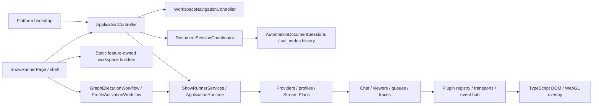

# Architecture

## Runtime boundaries

The Windows desktop is a Flutter/Dart application. The production browser overlay
is TypeScript/DOM/WebGL; OBS loads it as a Browser Source. Removing this package
would remove overlay functionality, not complete a desktop migration.

`sai_nodes_core` owns immutable graph entities, definitions, resolution and geometry.
`sai_nodes` provides the Flutter canvas. ShowRunner supplies domain definitions,
resource adapters, compiler/runtime behavior and editor UI. Both dependencies are
pinned to the published 1.0.0 packages in pubspec.yaml and pubspec.lock.

## Authoring and execution

AutomationDocument uses its current `schemaVersion: 1` host envelope and embeds the
canonical graph document, settings and metadata. The graph is the only authoring
source. Do not confuse this with the retired V2 schema; old formats are rejected.
Unsupported Stream Plan/automation documents remain inspectable as errors and cannot
be silently saved over. There are no old-format decoders or compatibility aliases.

All authoring changes use graph commands and transactional undo/redo. Clipboard
operations preserve transitive subgraph dependencies and remap semantic references.
Runtime traces, selected execution sessions and compiled projections are ephemeral;
they must not dirty saved graphs. Runtime entity IDs match authoring IDs.

GraphExecutionEngine is the execution boundary used by queues, profiles, Stream
Plans, plugin events and node runs. The production compiled engine uses a cached
flat program and Dart VM. The interpreter is retained as a correctness oracle.
Cancellation, guards and failures are propagated through actions and subgraphs.

`GraphInvocation` is the runtime request contract above the engine. It carries an
immutable document or repository file target, typed origin, entry node/space,
explicit dispatch policy, collection-snapshotted context, cancellation handle and
trace mode. Runtime handles/observers are not wire DTOs. Every evaluation gets
fresh collection state; opaque runtime capabilities remain explicit references.
`AutomationInvocationService` coordinates loading, queue preflight and execution
without retrying actions. `InvocationAccepted` contains an immutable enqueue
receipt and separately observable queue item; it is never a completed graph.
`InvocationCompleted` contains the actual engine result and timestamps. Failures
retain their stage, original exception and stack, including typed provider errors.

The execution pathway inventory preserves these intentional dispatch choices:

| Path | Dispatch and acknowledgement | Context and source |
| --- | --- | --- |
| Editor run / run from node | Always queue; editor awaits drain, or reports pending when paused | Fresh context, selected node/space, automation/file identity and queue/item trace link |
| Inline editor test | Direct, await completion | Fresh context, inline-test source and test trace mode |
| Profile activation/deactivation/triggers | Named/document queue when configured, otherwise direct | Registry state plus caller locals, event/trigger payload and profile/phase/trigger identity |
| Stream Plan phases and segment transitions | Document queue when configured, otherwise direct; transitions serialize | Caller locals/state plus streamPlan object/flat keys and plan/segment/phase identity |
| Chat commands and quick actions | Strict load then enqueue selected queue; counters/cooldowns acknowledge acceptance | Scoped values plus event/trigger views, command/action identity and platform |
| Remote button | Authenticated RPC emits an event; active profile determines dispatch | RPC acknowledgement is not graph completion; profile trigger supplies execution source |
| ShowRunner runAutomation / addToQueue | Respectively direct completion / explicit queue acceptance | Existing action context or payload/queuedAt/source wrapper; no implicit retry |

Queues capture a graph snapshot at enqueue and explicit replay uses that snapshot;
they do not reload a newer document at execution. Queue policy owns execution
tokens, timeout and gap. Direct execution retains the caller's cancellation handle.
Timeout signals cancellation and retains queue ownership until the operation
finishes cleanup; it cannot make a non-cooperative external action stop by itself.
The next queue item never overlaps that cleanup. Standalone queue disposal also
awaits the active operation and wakes owned gap timers before closing its stream.
Pending items remain pending at shutdown; completed/failed replay uses the captured
graph and nested inputs. Typed source metadata cannot overwrite that snapshot.
Compiler/cache and VM remain below invocation orchestration; the independent
interpreter stays available for differential correctness fixtures.

Each profile session owns its subscriptions, registry listeners and background
trigger invocations. Disposal cancels direct work, detaches event producers and
awaits cleanup. The runtime also owns activation/deactivation calls and closes all
sessions, including editor-created ones, before releasing its dependencies.
Concurrent managed activation is serialized per profile; generation checks prevent
an old replacement from recreating superseded subscriptions. Accepted queue items
remain independently owned by their queues. Background trigger failures are kept
as typed profile diagnostics and reported without raw event payloads in app logs.

Trace storage separates domain events/models, session production, retention and
the public service facade. Defaults retain 32 runs, 512 events, 1024 node states
and 2048 edge states per run; positive limits are validated. Snapshots are read-only
and expose event/node/edge truncation counters. Invocation counters are bounded
with retained node state; evicted sessions stop collecting new data. Trace retention
may evict old diagnostics, while graph execution continues independently.
The `events` stream is a coalesced change hint, not a complete event spool: every
subscriber retains at most the latest hint, including while paused. Ordered event
history and exact counters for retained nodes/edges come from snapshots. Flutter
canvases coalesce projection changes to one frame; projection never writes to an
authoring document. Shutdown cancels paused notifications without waiting for
consumers to resume. Stable insertion order resolves equal run timestamps.
Counters describe the current retained identity window; evicted identities lose
their prior totals if they later reappear.

Trace previews default to typed acknowledgement booleans and a fixed set of status
values. Arbitrary strings, scalar results, unknown fields, viewer data, raw resource
configuration and private message containers are omitted. Trusted runtime code may
declare public result fields with `TraceValuePolicy`; credential/private containers
stay denied recursively even under opt-in. This policy is not a saved-document or
wire setting. Preview collection/string/depth/encoded-size limits remain enforced,
and retained preview collections are immutable. Trace errors retain a domain code
or runtime type, not raw exception text/stack. The original exception/stack remains
at the invocation/application error boundary for operation handling. Execution
results used by graphs remain unchanged; privacy applies to diagnostic projection.

Stream Plan close reserves shutdown before cancelling its active graph tokens and
awaiting serialized transitions. Waiting transitions recheck close after their
predecessor, so they cannot reactivate the plan during shutdown. A failed new plan
activation becomes idle. A failed segment switch leaves its plan selected without
an active segment; reached new components receive reverse-order cleanup. Segment
and plan exit attempt remaining cleanup after failures, clear provisional state
and preserve original/cleanup errors. Arbitrary external actions cannot be rolled
back; no implicit retries or replay of already executed provider effects occurs.
Component callbacks must finish their own asynchronous cleanup. Named-queue plan
phases still acknowledge enqueue acceptance rather than graph completion.

Shader authoring uses the same immutable graph/core/canvas. Semantic changes
invalidate generated GLSL; presentation changes do not. Node previews use derived
documents. Shader source is compiled/rendered by the actual browser WebGL runtime.

### Compiler and VM responsibility boundaries

The production compiler retains control-flow lowering and subgraph traversal, where visited sets, loop stacks and deterministic edge correlation belong together. `CompilerLabels` owns relocation (including loop exits in operand 2) and rejects unresolved labels; `CompilerSlots` owns deterministic allocation and aliases. Pure VM cloning, path access, result normalization and wire indexing live in `vm_value_operations.dart`. The interpreter imports none of these helpers. Before running an action, the VM validates every compiled operand address and subgraph signature against the program; dynamic values, stack operations and execution limits remain runtime checks. The instruction set still has 16 opcodes.

### Program cache identity and semantic equality

The program LRU still keys by the entire canonical semantic payload, so correctness does not depend on a hash collision assumption. A separate identity map remembers one entry-space/node variant per immutable `AutomationDocument`, bounded to the same configured entry count. New document instances compute their payload and can reuse an existing program by equality; edits never reuse an identity fingerprint. Clearing the program cache also clears identity fingerprints. A zero entry count disables both stores. Presentation maps, frames/comments and host display/queue settings are excluded; node data, conservative node/space metadata, connection endpoints/data, entry choice and dependent subgraph signatures remain included. Plugin state and evaluation contexts are never cached. Hit/miss/signature-build counters are cumulative diagnostics.

## Plugins, persistence and remote control

Built-in Dart plugins own manifests, action/trigger contracts, runtimes and UI
contributions; see the [plugin layout](../packages/showrunner-flutter/lib/plugins/README.md).
`FirstPartyPluginContribution<Context>` describes a statically compiled module
factory with a concrete context, version and required/optional dependencies.
`DartPluginRegistry.registerModules` validates the entire pack before publishing
any contracts or notifying listeners. Dependencies initialize/start first and
stop last; absent optional dependencies are allowed, present cycles are rejected.
The composing caller retains ownership if validation fails. Composition is sealed
at initialization/startup; runtime state survives additions made before that point.
Flutter assembly supplies an immutable map of canonical resource editor owners
to first-party registries, enforcing coverage and ownership on every registration;
the module factory contract itself has no Flutter UI dependency.
Canonical resource descriptors live in each provider's `resources.dart` and are
imported directly by its manifest. The shared editor index derives its entries
from those immutable declarations and rejects duplicate/unknown type IDs; it
does not maintain a second plugin switch or copy resource defaults.
The default/configured registrars explicitly assemble provider-owned
`plugins/<provider>/bootstrap.dart` factories. They pass typed dependencies;
transport/account setup stays with the provider and shared HTTP, variable and
dashboard ports are constructed by their owning factories. The public bootstrap
is a facade. `first_party_plugin_ui.dart` assembles Flutter UI independently;
disabled integrations retain their settings; resource documents retain their drafts/history behind a read-only availability guard. IoT resource
routing lives in `plugins/iot/configured_resolver.dart`. These are statically
compiled first-party factories, not external plugin loading.

Plugin lifecycle states (`registered`, `initialized`, `starting`, `running`,
`stopping`, `stopped`, `disabled`, `failed`) describe module ownership separately
from enable policy and connection health. The current first-party enable policy
is `automationOnly`: disabling blocks graph actions and plugin visibility while
preserving settings/editors and shared chat, OBS, overlay and device connections.
Their existing host owners still stop them at shutdown. It is not a disconnect
button. A module disabled before host startup is skipped; first activation starts
it once, and toggling again never restarts or disposes that instance.

The asynchronous `setEnabled` host operation serializes policy changes, persists
before publishing and reverses persistence if first activation fails or shutdown
intervenes. Partial startup is cleaned once; failed modules require a new host.
Rollback failures retain both errors. Settings collection edits execute under the
same file transaction lock as other settings owners. Shutdown awaits pending
policy transactions, initialization/start and reverse dependency cleanup. Modules
that allocate during initialization are released even when disabled; native input
only calls platform teardown if events were actually requested. Late health
results are invalidated after policy changes or close.

Provider health is distinct from module ownership: local modules can be ready,
missing default connection settings report `notConfigured`, and configuration
without a successful probe reports an unverified/disconnected status rather than
green readiness. Per-resource connections can override missing defaults. Settings
and diagnostics use the registry health boundary, which skips disabled probes,
limits queries to ten seconds and invalidates stale results. Timeout does not
abort arbitrary transport work: protocol adapters remain responsible for their
own I/O cancellation and deadlines. Twitch/YouTube worker state remains the source
of truth for shared chat connections, separate from action transport readiness.
An unconfigured provider is not evidence of a successful external connection.

`ProviderOperationPolicy` defines shared request/body budgets, safe HTTP retry
classification and saturating reconnect backoff. `ProviderOperationScope` owns
physical abort callbacks and retry timers, rejects work after close and aborts
registered resources once in reverse order. Provider adapters retain protocol,
authentication, certificate and error semantics. Device HTTP has a whole-request
deadline and bounded response bodies; Kasa/LIFX retain TCP/UDP-specific budgets.
Configured default and per-resource clients share their module's cancellation
scope. Borrowed HTTP clients remain caller-owned. Mutations are not retried by
the common policy; existing provider-specific authentication refresh remains
separate. Wyze shutdown awaits rotated-token persistence already in progress.

The shared chat runtime owns separate Twitch/channel, bot-whisper and YouTube
request scopes. Starts, broadcast discovery and settings loads check the owning
platform's generation after asynchronous work; disconnect invalidates that
generation before awaiting cleanup. Old cleanup snapshots cannot stop a newer
session. Concurrent YouTube discovery shares credential resolution, and reconnect
reloads credentials. Explicit chat selection takes precedence over the last
selection, then saved settings. Stopping chat retains the last selection; stopping
the host clears it. Host shutdown awaits stop before disposing notifications.

The sound module closes the output registry, speech client and Windows file
synthesizer it creates; injected speech/output services remain caller-owned.
Output shutdown rejects new playback, assigns IDs to anonymous plays, aborts
active outputs and waits for playback cleanup. Non-abortable injected outputs
must finish themselves. Windows synthesis owns each child process, kills it on
host/action cancellation and drains process completion before shutdown returns.
TTS requests carry the action cancellation token through synthesis and speech;
cancelled synthesis cannot proceed to playback. Tests mock speech/process runners
and output callbacks; real device playback and audio quality remain opt-in.

Twitch and YouTube adapters publish `ProviderEventEnvelope` values containing
platform, domain event type, provider ID when supplied, account/channel identity,
time and a deeply immutable domain payload. Credential-shaped fields are removed
recursively; message text remains intact. The event hub projects that same domain
payload onto existing graph trigger channels, preserving IDs and field names.
Private whispers have a separate visibility and never enter the public typed feed.

The hub limits channel allocation to 256 and pending delivery to 4096 events per
subscriber, including paused subscribers. Publication preflights every recipient
before any accepts an event. Overflow throws a payload-free diagnostic; it never
evicts an accepted message. Typed and graph projections commit together. Twitch
and YouTube stop with an explicit error on overload, requiring an explicit restart
after consumers recover. Rejected Twitch IDs remain replayable; YouTube only
advances its cursor after accepted delivery and retains a bounded deduplication
set during restart. Protocol replay is required to recover rejected data; there
is no durable event spool. No-subscriber broadcast events are not retained. Host
shutdown cancels queued work and paused subscriptions deliberately. Downstream
asynchronous jobs remain owned by their command/automation queues; this bound
covers event delivery, not arbitrary futures spawned by a listener.

User data uses typed resource repositories, atomic writes and explicit validation.
Viewer data and secret settings have separate persistence boundaries. Tests use
isolated directories and must never seed or reset production storage.

Remote/Satellite dashboards exchange versioned resource, state and button messages.
They are not a mechanism to load desktop plugins into another process. The current
registered dashboard widgets are label and remote button; unknown kinds remain
visible placeholders. External plugin loading is intentionally deferred in ADR-003.

#### Resource editor contributions

`ResourceEditorContribution` is a Flutter-only boundary with canonical resource metadata, optional validation/read-only factories, editor/runtime factories and explicit save/dirty/undo capabilities. The registry imports contracts, not plugin widgets. The composition pack assembles provider-owned `ui/resource_editor_pack.dart` contributions; metadata/defaults come directly from `builtInResourceSpec`, without duplicate UI declarations or resource-type switches.

All resource editors are ordinary libraries. Overlay canvas, inspector, widget configuration and presentation live under `plugins/overlays/ui/editor`; dashboard forms and hierarchy/default/ID helpers have feature-owned libraries; audio split normalization stays with the sound editor. Overlay toolbar, palette and rename controls own presentation/focus while `OverlayEditorController` owns immutable authoring snapshots, semantic dirty state, history and asynchronous save publication. The page owns text/focus adapters and OBS/network lifecycle. Shared form/value controls live in `components/data_inputs`. Stream Plan segment state exposes a snapshot API to its parent editor while retaining ownership of inline graph controllers. Unknown types, disabled contributions and malformed collection shapes use a read-only inspector that does not render loaded credentials. Workspace document availability follows registry notifications; disabled owners hide and unfocus the mounted editor without disposing its draft/history. Modal opening and document save/delete paths also check owner availability. Re-enabling restores the retained editor. Save failures keep form drafts open and suppress duplicate submissions; error messages do not echo arbitrary exception contents.

## Flutter workspace view state

Use feature-local controllers/models/widgets/dialogs/services where a concrete ownership boundary warrants them, without a global workspace framework. Persisted domain documents remain authoritative; search, panel visibility, focus, selection and in-flight UI status are view state. Widgets render snapshots and invoke commands; they do not mutate loaded resource maps. Keep graph authoring/history with `sai_nodes`, and keep transport/filesystem work outside rendering. Controller/listener extraction needs behavioral or measured rebuild evidence, not a line-count target. Reuse existing sidebar/tabs; independent docking requires the ADR-004 product decision and restoration tests.

`OverlayEditorController` deep-freezes accepted configuration/state, preserves unknown fields and stable layer identities through reorder/delete, and uses unpersisted view tokens when a shipped layer has no ID. Selection does not change authoring revision. Semantic equality determines dirty state; canvas transactions coalesce into one undo entry, retaining at most 100 undo snapshots. Save captures an immutable generation before asynchronous work and shares one pending result. Later edits stay dirty; disposed/replaced owners cannot publish delayed completion into another document. Text field adapters remain local to Flutter and reload after undo/redo or a resource identity switch. Initial document callbacks publish a clean snapshot, including when subpixel gestures produce no semantic change. Error presentation never interpolates arbitrary save exceptions.

`EditorLayoutPolicy` classifies actual editor constraints after application chrome: compact below 900 logical pixels of width or 560 of height, wide at least 1440 by 800, standard otherwise. The standard/wide overlay inspector retains its reviewed 352-pixel width. Compact layout overlays the inspector/layers panel rather than taking canvas width, caps the vertically scrollable toolbar at 35% of editor height and keeps save outside the panel. Ctrl+I and an accessible footer button toggle the panel. Keyed canvas/sidebar regions, stable toolbar ancestors and a feature-owned splitter preserve mounted input/split state across layout changes. These are local layout states, not workspace docking or new persisted settings.

`OverlayPresenceController` owns a generation-scoped runtime observer, one non-overlapping poll and a cancellable polling timer. Reader startup, delayed responses and foreign resource identities cannot replace the current status. Equal view snapshots do not notify. URL/status widgets and layer subtitles listen directly, so presence changes do not rebuild the authoring canvas or inspector. Synchronous disposal stops admission/timers and invalidates replies; an explicit `close` drains accepted observers when a caller can await. The application service retains ownership of underlying provider I/O, which view disposal does not physically cancel. Browser-source clipboard/launch affordances live in their own presentation widget and do no I/O during build.

`OverlayObsController` borrows the app-owned OBS source facade and owns connection selection, immutable status views, debounced/coalesced inspection and pending source operations. Each operation captures resource, connection, dimensions and port lookup with an opaque context token; stale dialogs and target changes during lookup cannot start writes. Reader generations reject A-to-B-to-A and pre-write replies. Duplicate writes share pending ownership; accepted provider calls retain their original target and are drained by explicit close without closing the shared service. Widget disposal invalidates publication and stops debounce admission. Only the toolbar listens to OBS status; ordinary rebuilds do not query storage/network. History changes explicitly update source dimensions. This is editor orchestration, not provider transport ownership.

Preview dialogs own their text controllers and latent disabled form values. Live edits capture the opening document owner; an old dialog or delayed inspector result cannot change a replacement document. Known preview fields are overlaid on retained extra configuration. Presentation identity resets when the resource changes, while resizing retains the mounted fields.

Structured style inputs are ordinary libraries under `components/data_inputs/style`: font preview/family/editor, alignment, geometry, outline, background and gradient, with shared `InspectorSection`, `NullableStyleField` and `SchemaFieldRenderer`. Schema metadata remains Flutter-free. Font rendering derives from the current authoring value rather than a second mutable style copy. Text fields retain partial numeric input during their own model echo but accept external undo/value changes without dropping focus. Normalization preserves absent/null optional style subgroups and zero-valued effects; defaults initialize new groups rather than resurrecting removed effects.

Automation graph presentation uses separate toolbar, node picker, inspector, schema-loading field and parameter dialog libraries. The `sai_nodes` editor remains the single authoring/history/geometry owner. Runtime traces are observed only by the execution bar and canvas execution source, not the workspace authoring controls. Pick/search results capture their opening editor; node creation also captures the space. Replacing an editor dismisses its compact inspector and invalidates UI run-completion publication without cancelling app-owned execution. Parameter submission checks the current semantic subgraph signature before replacing it. Resource-option futures are owned by the field, reload on schema/loader changes or explicit retry, ignore replaced futures and show payload-free failures. Long subgraph names are ellipsized with a tooltip within the existing wrap toolbar.

`OverlayLayersPanel` owns layer presentation and action menus without keeping another document or selection model. Popup results resolve their captured view token against the opening editor at submission time, so reordering cannot retarget an action. Presence text remains independently observed. Diagnostic graph dialogs likewise snapshot their opening editor/issues and reject navigation into a replacement document.

Shader presentation has separate toolbar, palette, inspector, find dialog and compile panel libraries around the existing shader controller. Palette filtering is local state; hiding/resizing retains the mounted palette and its query. Resetting/loading a graph invalidates old picker results. Ctrl+F, fit and grid snapping reuse shared scene/canvas controls. Compile/application eligibility depends on semantic revision and valid fields, not camera motion or selection.

The variables catalog controller caches immutable definition rows and coalesces reads; current-value changes notify keyed value fields without re-reading definitions or rebuilding viewer queries. Viewer query/definition generations reject superseded responses and retain the repository/revision captured by a form. Twitch chat activity has its own bounded observer and leaf widgets. Channel refresh, provider status, active Stream Plans and named queue counters are observed at their dashboard cards; app runtimes still own providers, plans and queues.

Integration metadata/search/usage is composed separately from settings drafts and interface preferences. `PluginSettingsSnapshot` reads only declared settings and preserves unknown fields/revisions. Shared typed setting fields reject malformed/non-finite numbers. Each form captures its project/registry owner before loading, OAuth or writes; obsolete completion cannot replace current drafts. Diagnostic configuration previews fail closed for secret/unknown fields and unavailable schemas without changing saved data.

Resources cache their catalog future, capture project/editor/registry/runtime owners for asynchronous routing and resolve modal CRUD against the original repository. Profile forms retain editor histories and the accepted save baseline without reloading over newer edits. Trigger selection and inline graph panels are separate leaves; replaced selections reject delayed choices, loads and activation publication. Close guards await managed activation shutdown. The old never-assigned local profile-session field is removed rather than adding a second session owner.

Chat history/events, actions, command persistence/counters and provider work stay in the existing runtime/managers. The separately observed virtualized timeline no longer rebuilds search/filters for every message. Composer focus/completions and send state remain presentation state; completion clears only the accepted draft. Command dialogs own controllers/permissions/cooldowns and reject submission through a replacement manager. Remote discovery uses an extracted service and a cached future with obsolete replies rejected by its view owner; connection/RPC work captures the opening runtime context. Diagnostics cache plugin-health reads outside rendering and refresh explicitly. Shared workspace notices and payload-free statuses keep provider/parser errors out of public UI.

Phase 05 covers these editor and auxiliary workspace ownership boundaries. Existing sidebar/tabs, immutable document formats and frozen visual references remain the contracts; no independent docking or blanket repaint/virtualization framework is introduced. Further performance work requires concrete rebuild/frame evidence.

## Persisted document ownership and current recovery boundary

`persistence/persisted_document_catalog.dart` describes paths, codec families, authority and required write scopes without containing runtime instances or secret values. Resource entries derive from the same provider-owned declarations as graph/editor contracts; IDs and existing JSON/YAML choices remain unchanged. Only automations and chat document families carry explicit envelope versions today; profile/resource/viewer/settings codecs retain their shipped shapes, including embedded version-1 automations. The catalog is not an alternate decoder or migration layer.

| Document family | Authoritative bytes and owner | Separate durable/secret state and recovery requirement |
| --- | --- | --- |
| Automations, profiles | `automations/{file}.yaml`, `profiles/{file}.yaml`; host-owned typed codecs, JSON output/YAML parser input | No execution traces, selection, cancellation or subscriptions in authoring data; reject unsupported graphs and leave source available for inspection |
| All 20 resource types, including Stream Plans, dashboards, overlays, variables, device connections and accounts | Canonical provider `storageDirectory`, `{id}.json` envelope or existing `{id}.yaml` config | YAML state in `.state/{id}.json`; declared secrets in `secrets/resources/{type}/{id}.yaml`; these form one required coherence group |
| Queues | `queues/{file}.yaml` configuration | `QueueRepository` takes an explicit history file; host composition currently binds no fixed history file. Pending snapshots/history are durable runtime data, not live cancellation handles |
| Viewer definitions/rows | `viewer-data/variables.yaml`; `{provider}/{base64url(id)}.json` | Provider qualification and IDs belong to the codec; corrupt rows/definitions must become observable rather than silently merging platforms or resetting values |
| Plugin settings and accounts | `settings/{plugin}.yaml`; accounts use their provider-owned resource directories | Declared secret fields only in per-plugin/resource DPAPI ciphertext files. Public/secret settings are one required coherence group; unavailable secrets must be distinguished from missing settings |
| Chat preferences/actions/commands | `settings/chat.yaml`, `settings/chat-actions.yaml`, `chat-commands.json`; version 1 | Version-1 counters in `state/chat-command-counters.json`; command counters are not disposable cache data |
| Workspace/window state | `settings/showrunner-flutter.yaml`, `state/window.json` | UI state is separate from authored graphs; malformed input must not authorize resetting unrelated documents |

OBS source choices belong to overlay configuration. The external OBS profile itself remains OBS-owned; tests use the portable instance and never rewrite user profiles. Secrets catalogs contain field names only. File/version/decryption errors require an actionable read-only/error path, preserving bytes for inspection and explicit retry/repair.

The Phase 04 failure probes reproduce and now prevent mixed credential/config generations, hidden decryption failures, plaintext fallback without a secret adapter, unsupported envelopes and filename/identity confusion. Per-file atomic rename alone is not the multi-file transaction or stale-write policy; the repository owner supplies both, using isolated fixtures rather than production data.

Resource save/delete now uses a version-1 redo journal at `.transactions/{id}.json` and a persistent OS lock at `.locks/{id}.lock`, in addition to in-process serialization. Target names are a closed vocabulary resolved by the owner; journal input cannot supply filesystem paths. The journal contains public document bytes and already encrypted secret bytes, before/after SHA-256 fingerprints and no decoded credentials. Each member is still published by atomic replacement. All repository readers finish a pending generation under the same lock before returning data; pending creations are also discovered by catalog enumeration.

An I/O error after the journal is durable can leave a pending save even though some members changed. Keep the editor dirty, restore filesystem access and retry/reload: recovery completes that generation, including interrupted deletion. A changed member that matches neither the old nor the new fingerprint blocks recovery without overwriting external changes. Unsupported/checksum-invalid journals stay untouched. Cleanup failure can leave a fully applied generation plus its journal; recovery verifies and removes it. Raw filesystem readers are not promised a simultaneous cross-file snapshot; integrations must use the repository boundary. Resource editors retain an in-memory semantic `DocumentRevision` separately from authoring documents. Saves and deletes compare that baseline under the owner lock after recovery; object key order is normalized, list order remains significant and errors never print fingerprints or values. New creation can require absence. Modal editors and overlay/Stream Plan sessions advance their baseline after accepted writes without clearing newer drafts. Repository callers performing deliberate unconditional replacement must opt into their own ownership policy by omitting the expected revision; the recovery fingerprints alone do not detect stale edits. Plugin settings use the same journal and OS owner lock through the typed `PluginSettingsStore`; the application service delegates loading, saving, existence checks and transformations to that owner. Transformations read their current settings inside the lock. Unknown fields already stored in encrypted files remain opaque: only declared secret fields merge into editor/provider snapshots. Unknown sealed keys cannot shadow public metadata, are omitted from public projections, and survive resaves/transformations without accepting accidental replacement values. The secret owner retains their ciphertext-backed contents for settings and resources alike.

Path resolution checks existing ancestors without following a link when deciding whether it exists; dangling junctions fail closed rather than appearing to be missing files. This is pathname containment, not a kernel no-follow handle contract: an adversary able to replace ancestors during a filesystem operation remains outside its race guarantees. YAML conversion is shared across repositories and rejects recursive aliases without including source values in its error. DPAPI input/output native buffers are cleared before release.

Automation/profile repositories implement domain store contracts; queue configurations share `TypedDocumentFile<T>`. Single-file documents retain their shipped serialization and need atomic replacement under the OS owner lock, without a redundant redo journal. Loading is strict; save/delete validate existing documents before revision checks and never rewrite unsupported bytes. Inputs are serialized before the first await. Graph sessions keep storage baselines outside immutable documents, while their graph history revision still decides whether a completed write clears dirty state. Profile/queue dialogs and project rename actions compare their original snapshots; creation requires an unused identity.

`ShowRunnerDataService` delegates document access to `ProjectStorage`. Canonical resource contracts determine repository paths; automations/profiles/queues/viewer data have typed factories, and the unused generic YAML resource writer is removed. `PersistenceDirectory` retains the application root while resolving nested directories, member files, journals and owner locks. A junction at a resource/settings/secrets directory cannot redefine the allowed root. Standalone adapters may still receive an explicitly owned fixture directory. OBS setup and Hue discovery receive repositories rather than inferring secret roots or resource paths. Resource enumeration retains safe diagnostics for unreadable entries, and parser errors omit their source payload.

Provider resource contracts own configuration codecs independently of Flutter. Storage and editor contributions use the same codec; complex overlay, dashboard and Stream Plan collections reject malformed shapes without discarding fields. Unversioned formats remain unversioned, and unknown configuration/segment fields survive semantic round trips. Explicit null queue timeout means unbounded; an omitted timeout retains the existing 30-second default. Unsupported schemas have a distinct source-free error type; malformed syntax remains separately classified. YAML map keys must be strings to avoid coercion collisions.

Project catalog aggregation uses every canonical resource contract and isolates per-directory query failures as safe `PersistenceIssue` metadata; healthy directories still load. The project-panel controller caches the query future by storage scope and explicit revision, not transient service object identity or expansion/widget notifications. It owns one filesystem watcher, a coalescing invalidation timer, retired subscriptions and in-flight catalog reads. Settings, lock files, journals and runtime sidecars do not invalidate the project tree; authoritative file notifications trigger reads through repository locks/recovery. Controller close cancels admission/timers, awaits watcher stops and drains owned reads. Stale callbacks from a previous storage root are rejected by generation.

Settings saves and transformations optionally compare the loaded semantic revision under the same owner lock as public/secret publication. Settings/setup/provider forms retain their actual storage baseline independently from displayed defaults. Background refresh updates patch current settings instead of replaying startup maps. The chat dock reads one recovered settings generation and publishes its token/port in one transaction. Account login writes compare the resource they read; YouTube fetches and validates the channel before publishing credentials and identity together, so profile failure or an intervening settings edit preserves the previous generation.

Variable runtime writes patch only durable state under the resource owner lock, re-reading current authoring config and preserving unrelated fields. Deleted resources are not recreated, and newly disabled persistence or a changed variable type blocks a stale runtime write. Accepted mutations serialize by canonical variable ID, including aliases, and share initial loading; shutdown drains these operations before registry teardown.

Viewer row operations share per-identity OS locks across file repository instances; in-memory mutations serialize on an owned per-identity queue. Provider-qualified keys and group values remain unchanged. Definition edits compare semantic revisions under their own lock. Malformed definitions cannot authorize replacement; corrupt/mismatched rows fail visibly with payload-free errors. Both adapters run the same fixtures for defaults, scoping, groups, import policy, pagination, concurrent increments and stale schema edits. File readers validate contained paths before accessing provider rows.

The real-filesystem tests interrupt each journal/member write before and after publication, interrupt deletion/cleanup, simulate an abrupt process exit and verify an independent process cannot acquire a held lock. Resource fixtures assert config/state/credential generation equality and scan staged payloads for plaintext secrets. Windows DPAPI itself is exercised on isolated fixture bytes, alongside injected ciphers for deterministic faults.

## Verification boundaries

Frozen Electron contracts/screenshots provide historical comparison evidence, not
a second maintained application. Contract inventory and screenshot differences are
separate measurements. A green contract/catalog job is not a pixel-parity claim.
See [testing](testing.md) and [product status](product-parity.md).

## Dependency and lifecycle ownership

`main.dart` owns platform bootstrap and launches the app. `ApplicationController`
owns startup, restoration and asynchronous teardown. `ShowRunnerPage` borrows its
models and hosts dialogs, command bindings and canvas/trace view state.

The former page field/callback clusters have explicit owners:

| Cluster | Owner and boundary |
| --- | --- |
| Tabs, destination/resource selection, restored navigation | `WorkspaceNavigationController`; immutable snapshots, validated settings codec, ordered startup requests and serialized/debounced persistence |
| Automation editor/history, overlay/plan drafts, save/close/delete and dirty decisions | `DocumentSessionCoordinator`; existing session managers and typed repositories remain authoritative; revision/identity checks protect newer edits from late saves |
| Run graph/from-node and profile activation | `GraphExecutionWorkflow` and `ProfileActivationWorkflow`; queue/execution boundary, no compilation in widget state; trace selection stays ephemeral in the canvas adapter |
| Startup, registry binding and model disposal | `ApplicationController` and `ShowRunnerServices`; the view adopts one owner and retains its shutdown future |
| Window/tray decisions and dirty guards | `WindowCloseCoordinator`; prompts/window operations remain injected UI callbacks |
| Dialog presentation, profile editor dirty flag/controller, canvas key, trace adapter, catalog refresh revision and command bindings | Local page/view state; no parallel authoring model |
| Workspace construction and dependencies | Static feature registrations plus seven immutable scoped capability bundles; borrowed services/controllers are explicit fields, resource maps/tab lists are copied snapshots |

Ownership is acquired at construction, including resources without a start hook.
`ApplicationRuntime` starts in dependency order and stops in reverse order, attempts
all releases and reports named failures before rethrowing the first one. Repeated
start/stop calls share completion futures. Failed startup releases constructed
resources; restarting requires a new application/service graph, not reusing a
partially stopped instance. Plugin cleanup stops only reached modules once startup
has begun; never-started registries still release constructor-owned resources.

| Resource / constructor owner | Starter and disposer | Last dependent / cancellation and drain | Restart and executable evidence |
| --- | --- | --- | --- |
| Navigation / `ApplicationController.create` | Owner start restores; owner shutdown calls `close` | Documents restore before tab availability; timer cancelled and serialized writes flushed; atomic settings patches preserve unrelated preferences | New owner; `workspace_navigation_controller_test.dart`, `application_controller_test.dart` |
| Document sessions and scratch editor / document coordinator | Restore/open; coordinator `close` | Cancels modal decisions, waits pending writes, disposes sessions, then awaits retained editor teardown | New coordinator; `document_session_coordinator_test.dart`, `automation_document_sessions_test.dart` |
| Interface preferences / application owner | Owner load/close | Retains load and outstanding writes; prevents late notifications | New owner; `interface_preferences_test.dart` |
| Event hub / services factory | Constructed before dependents; hub disposed last | Provider/listener and queue/registry consumers stop first | New service graph; `showrunner_services_test.dart` |
| Startup health / services factory | Load at construction; graph start and stop await the same snapshot | Read-only filesystem probe finishes before storage ownership ends; result retains ready/offline/error | New service graph; startup-health/service tests |
| Variable notifier / services factory | Registry starts loading; service graph awaits `close` before registry disposal | Views and registry contracts borrow it; queue/profile/plan producers stop first, then pending variable edits/load/reload finish while registry callbacks are still valid | New service graph; variable blocked-write and service lifecycle tests |
| Overlay OBS source helper / services factory | Lazy use; service graph closes after plugin registry | Plugin helpers release listeners/transports before the event hub | New service graph; service and overlay bridge tests |
| Plugin registry and configured transports / services factory | Service graph initializes/starts, then closes | Queues/traces/profile/plan/provider dependents stop before registry; registry awaits in-flight start and reverse module disposal | New registry; `plugin_registry_test.dart`, injected failed-start/port-release service tests |
| Execution traces and queues / services factory | Created before runtime producers; graph disposes | Cancel running tokens, wake gap waits, await pending loads and drains, then close queue streams before trace sink | New graph; `automation_queue_manager_test.dart`, `execution_trace_test.dart` |
| Viewer synchronizer / services factory | Graph start/stop | Cancel subscriptions/generation before awaiting active repository writes and hub delivery | Can start after completed stop; `viewer_data_sync_test.dart` blocks a real atomic write |
| Chat runtime and dock / services factory | Graph start/restore; dock stops before chat closes | Identity listener/providers stop first; dock closes listener/peers, chat releases subscriptions/timers | New service graph; chat/dock suites and native chat fixture |
| Stream Plans / services factory | Borrowed by registry actions, documents and UI; graph closes | Wait transition chain, deactivate while registry/queues still exist; no global runtime shared across applications | New graph; service isolation and `stream_plan_test.dart` |
| Profile manager/runtime / services factory | Graph starts manager; awaits dispose | Stop provider events first, detach registry listener, await refresh, release managed sessions even after refresh failure | New graph; profile/service lifecycle suites |
| Provider workers / services factory | Graph start/stop | Stop event production and await workers before profile/plan/chat/viewer/queue sinks close | New graph; provider lifecycle suites |
| Chat identity listener / services factory | Graph attaches last, detaches first | Disable callback, remove listener and await serialized identity refresh | New graph; service lifecycle tests |
| Temporary graph plugin registries / editor controller | Editor binding; retained `teardownComplete` awaited by session owner | Borrowed app registry is never closed by editor; only owned temporary registry is released | New editor; editor/session suites |
| Tray, logger and instance lock / page host | Host initializes; retained host lifecycle future releases | Tray awaits partial initialization; logger flush and instance-lock release follow application teardown | New host; `showrunner_tray_test.dart`, lifecycle and native fixtures |

Window shutdown has a diagnostic deadline only at the host boundary. Timeout
keeps the native window open and reports that teardown is still running; it does
not cancel or silently declare success for owned work. Widget `dispose` starts the
same retained owner future because Flutter cannot await disposal. Explicit host
callers can await `ApplicationController.shutdown`. Dirty cancel/hide-to-tray
never starts shutdown. Settings/documents are flushed before accepted native exit.
The close boundary is covered by `window_close_coordinator_test.dart`.

These types are integration seams, not an ABI guarantee for third-party code.
External plugins remain isolated and versioned under [ADR-003](architecture/adr-003-external-plugins.md).
No in-process loader, Electron/Vue revival, Timeline editor or silent migration is
part of this baseline. Arbitrary docking requires [ADR-004](architecture/adr-004-workspace-docking.md).

## Network trust review

The baseline phase is in progress. Bindings and ACLs below are source-reviewed;
only the explicit reproducers are confirmed issues. A configurable listener is
not by itself an exploit. All probes use ephemeral loopback ports and isolated
stores, never a running user service. Host/Origin validation prevents browser
cross-origin requests and rebinding-style forged authorities; it is not LAN
authentication and does not establish an end-to-end DNS-rebinding exploit.

| Surface and audience | Inputs, outputs and authorization | Limits and evidence |
| --- | --- | --- |
| Overlay HTTP, OBS same host or opted-in trusted LAN | Default `127.0.0.1:8181`; `allowRemoteAccess` binds anyIPv4. Public GET `/overlays/<id>` and `/overlays/assets/*`; authenticated `/overlays/<id>/config` and `/overlays/<id>/media/*`. Fragment capability bootstraps an HttpOnly, SameSite=Strict cookie scoped to that overlay path; contained asset/media paths remain enforced | Shared Host/Origin guard before handlers; local IPs, localhost and the machine hostname remain supported. Existing isolated fixture verifies config projection, unknown IDs and foreign-origin rejection. Junction escape protection has a Windows persistence fixture |
| Overlay WebSocket, same listener | Upgrade `/overlays/<id>/socket`, versioned resource-bound request/response IDs; config/widget/broadcast/audio notifications; plugin state acquisition and viewer schemas/query/events. Overlay-scoped capability plus same-origin guard; state/viewer projection follows installed widget capabilities and saved bindings | 1 MiB inbound messages, 64 pending outbound RPCs, 20-second default RPC deadline. Malformed JSON/binary/oversized frames close only their peer. Silent initial config ACK expires. 32 joining/connected peers, 16 actual inbound operations, 256 recent replay IDs, 64 state subscriptions and 100-row viewer pages. Aggregate rate and full repository scan cost remain open |
| Dynamic profile HTTP triggers | `/plugins/endpoints/<route>` with GET/POST/PUT/PATCH/DELETE, route/query/body to active profile subscriptions. Same bind as overlay; no token. Cancellation unregisters the route | 1 MiB body, 20-second dispatch/body timeout, Host/Origin validation. Timeout is not proof of cancellation of a handler already executing |
| Remote button HTTP, explicitly enabled local integration | Disabled by default; `127.0.0.1:8390`, configurable host. GET `/buttons`; POST `/buttons/press?button=...` emits a named trigger. No bearer credential | Host/Origin guard before enumeration or action. Local native callers without Origin remain supported. Opted-in LAN access still trusts network peers; authentication, replay and rate quotas remain open |
| Chat OBS dock | Separate loopback-only port; `/api/*` requires `x-showrunner-chat`, 32 random bytes stored in secret settings. HTML URL fragment carries bootstrap capability; no query token, browser storage or shared overlay token | Exact Host/Origin, no-store/no-referrer/CSP. POST bodies limited to 8 KiB, preferences 256 KiB, stream idle deadline 10 seconds. Private messages excluded. Existing dock tests probe forged Host/Origin even with valid credential |
| OAuth callbacks | Ephemeral loopback listener; Twitch uses fixed supported callback port. Random state, YouTube authorization code with PKCE; Twitch fragment forwarded by local callback page | Five-minute callback wait. Isolated OAuth fixtures cover callback/state flow. Host/body quotas and cancellation under slow malformed clients require additional review |
| Remote/Satellite dashboards | Outbound authenticated cloud signaling plus WebRTC data channels. Shared dashboard ID and `remoteTwitchIds` ACL checked before accepting a connection; widget RPC resolves the shared dashboard | Simulated signaling/peer fixtures verify ACL and button RPC. Cloud identity attestation, peer replay, data-channel quotas and live revocation behavior still need proof; payload identity alone is not authentication evidence |
| Provider and native adapters | Outbound OBS/provider WebSockets/HTTPS, configured Minecraft/Kasa TCP; LIFX binds wildcard UDP on ephemeral ports for discovery/control; WebRTC ICE, OS BLE/audio/native window adapters | Separate device/provider principals. No general plugin loader or desktop RPC listener. Real cloud, UDP devices, ICE/BLE and audible output remain manual/opt-in |

Confirmed isolated reproducers and fixes:

- The HTTP listener accepted a matching attacker-controlled Host/Origin and invoked
  a registered handler (204). It now rejects the authority before routing (403).
- Remote buttons accepted a foreign-Origin POST and emitted its trigger (204).
  Both foreign-origin and forged-authority probes now return 403 before dispatch.
- Overlay JSON parsing raised an unhandled asynchronous exception and left the
  peer connected. The malformed-frame fixture failed before the patch; the peer
  now closes with an invalid-payload status. Additional bounds cover oversized,
  binary and unresponsive peers. The current wire envelope is described below;
  logical RPC names remain unchanged.

### Overlay wire contract

`tools/overlay_registry/overlay-protocol.schema.json` owns the shared resource RPC
envelope used by overlay WebSockets and Remote/Satellite control data channels.
`overlay:generate` emits the Dart and TypeScript codecs from that schema and the
adjacent runtime templates. Both runtimes consume the same accepted/rejected
fixtures in `test/fixtures/overlay-protocol.json`. This is an atomic desktop/browser
rollout: unsupported versions and old unversioned wire frames are rejected rather
than decoded by a compatibility path. The browser bundle and desktop must ship
together. Widget metadata retains its existing generated registry source.

Every envelope carries `protocolVersion: 1`, `resourceId`, `requestId`, `type` and
`payload`. Requests contain `{name, args}`, responses `{result}` and errors
`{code: "rpc_failed"}`. IDs/method names are nonempty strings of at most 128 UTF-16
code units; argument lists have at most 32 elements. Unknown envelope/payload
fields, types, versions, error codes and mismatched resource IDs fail validation
before dispatch. Domain exceptions never become wire error text. Method-specific
argument validation and capability checks remain dispatcher responsibilities.

Browser-to-desktop methods are `overlays_acquireState`, `overlays_freeState`,
`overlays_widgetRPC`, `overlays_observeViewerData`, `overlays_unobserveViewerData`,
`overlays_queryViewerData` and `overlays_getViewerVariables`. Desktop-to-browser
methods are `overlays_setConfig`, `overlays_stateUpdate`, `overlays_widget`,
`overlays_widgetRPC`, `overlays_broadcast`, `overlays_playAudio`,
`overlays_cancelAudio` and viewer data/variable notifications handled by the
browser runtime. HTTP config/media, Satellite signaling and chat dock HTTP remain
distinct boundaries; this envelope does not authenticate them.

Remote control uses the same generated envelope with the dashboard resource ID.
The host and satellite reject wrong IDs, unknown versions, oversized frames and
recent replay before dispatch. A 256-ID replay window and 16 active operations
bound one channel; each side permits at most 64 pending outbound requests.
The host reloads the shared dashboard and rechecks the connection/ACL before
commands, resolves buttons from that current document and closes revoked sessions
on refresh. Satellite disconnect has one awaited channel/peer cleanup sequence;
disposed or superseded channels cannot publish late messages or state changes.
These are data-channel checks, not evidence of cloud identity attestation or live
network pairing. SDP/ICE signaling retains its separate contract.

Chat dock HTTP remains a separate authenticated consumer. `ChatDockService` owns
serialized listener startup/shutdown and secret settings; `ChatDockHttpHandler`
captures one immutable port/root/token and owns routing, trust checks, body limits
and static files. `ChatDockRequest` validates a sealed set of send, configured
action, quick action, preferences and clear requests before runtime execution.
Unknown fields, malformed identities/platforms/actions and platform message limits
return safe validation codes. JSON syntax errors, unsupported preferences, missing
targets, timeout and operation failures have distinct codes without provider text.
Snapshot projection excludes whispers and bot whispers defensively; moderation
privileges remain enforced by the runtime/provider. Polling frequency and full
snapshots remain unchanged pending payload/DOM measurements.

The service admits at most 32 connected or joining peers. Each peer owns up to
64 outbound RPC deadlines and 16 actual inbound operations. Expired work retains
its admission slot until it really finishes. A bounded window of 256 recent IDs
rejects immediate request replay; it is not durable replay protection. Close
settles pending calls, cancels timers and prevents late socket writes. Browser
pending calls are capped at 64, a stalled handshake expires after 20 seconds and
buffer saturation closes the transport. Host/Origin checks and the 1 MiB frame
limit remain independent of this schema. Shutdown invalidates HTTP dispatch
generations and skips handlers/routes withdrawn while awaiting earlier work;
already executing domain operations are not forcibly cancelled.

The original known-ID access path is now closed: config, media and WebSocket
operations require an overlay-scoped capability, independent of the dock token.
A random 32-byte installation secret lives in encrypted overlay settings; HMAC
capabilities are bound to overlay IDs and remain stable across restarts. The
fragment is exchanged by same-origin POST for an HttpOnly, SameSite=Strict cookie
with an overlay-specific path. Neither public settings nor config projections
contain that secret. Legacy root media/socket routes are removed. Existing OBS
Browser Sources require the current editor-generated URL; tests do not rewrite
user profiles. Loopback and opted-in trusted LAN remain supported; plain HTTP on
that opted-in LAN is not a claim of confidentiality on hostile networks. `OverlayProjectionPolicy` selects public states from generated widget
`stateFields` metadata and saved shader binding paths; shader bindings cannot
project an entire provider object. Viewer access requires a configured leaderboard
and exposes its selected/sort fields plus public identity fields. Query and event
projections share the same filtering. Credential keys, local filesystem paths,
non-finite values, deep/cyclic structures and excessive strings are excluded or
bounded. Policies refresh on resource reload and validated requests; removed
subscriptions are pruned before subsequent pushes. A page has at most 100 rows
and 512 KiB of projected JSON; each provider supplies only its required sorted
prefix before the numeric-aware global merge. The file repository still scans
its local catalog to sort: response bounds do not prove indexed storage or a
network-wide aggregate rate limit. Widget config projection is a separate resource
handler boundary.

Secret storage tests verify real Windows DPAPI encrypt/decrypt on isolated bytes,
declared public/secret separation, opaque unknown encrypted fields and unavailable
credential failures. Injected ciphers additionally make fault recovery deterministic.
Overlay config responses project resource fields, not plugin settings;
the transport fixture also places a synthetic top-level token marker outside that
projection. These are scoped proofs, not a claim that arbitrary widget config or
every remote error path has been exhaustively reviewed. Further secret-projection,
shader-input, emote-host and data-channel failure-path tests remain part of the
baseline exit gate. See the [behavior contract matrix](testing.md#baseline-and-behavior-contracts).
