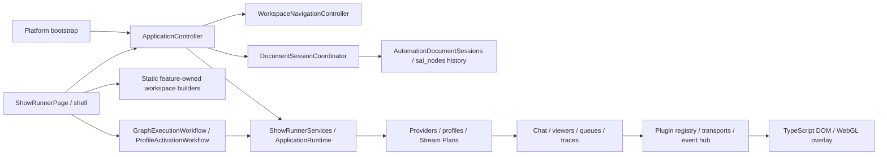

# Architecture

## Runtime boundaries

The Windows desktop is a Flutter/Dart application. The production browser overlay
is TypeScript/DOM/WebGL; OBS loads it as a Browser Source. Removing this package
would remove overlay functionality, not complete a desktop migration.

`sai_nodes_core` owns immutable graph entities, definitions, resolution and geometry.
`sai_nodes` provides the Flutter canvas. ShowRunner supplies domain definitions,
resource adapters, compiler/runtime behavior and editor UI. Both dependencies are
pinned to the published 1.0.0 packages in pubspec.yaml and pubspec.lock.

## Authoring and execution

AutomationDocument uses its current `schemaVersion: 1` host envelope and embeds the
canonical graph document, settings and metadata. The graph is the only authoring
source. Do not confuse this with the retired V2 schema; old formats are rejected.
Unsupported Stream Plan/automation documents remain inspectable as errors and cannot
be silently saved over. There are no old-format decoders or compatibility aliases.

All authoring changes use graph commands and transactional undo/redo. Clipboard
operations preserve transitive subgraph dependencies and remap semantic references.
Runtime traces, selected execution sessions and compiled projections are ephemeral;
they must not dirty saved graphs. Runtime entity IDs match authoring IDs.

GraphExecutionEngine is the execution boundary used by queues, profiles, Stream
Plans, plugin events and node runs. The production compiled engine uses a cached
flat program and Dart VM. The interpreter is retained as a correctness oracle.
Cancellation, guards and failures are propagated through actions and subgraphs.

`GraphInvocation` is the runtime request contract above the engine. It carries an
immutable document or repository file target, typed origin, entry node/space,
explicit dispatch policy, collection-snapshotted context, cancellation handle and
trace mode. Runtime handles/observers are not wire DTOs. Every evaluation gets
fresh collection state; opaque runtime capabilities remain explicit references.
`AutomationInvocationService` coordinates loading, queue preflight and execution
without retrying actions. `InvocationAccepted` contains an immutable enqueue
receipt and separately observable queue item; it is never a completed graph.
`InvocationCompleted` contains the actual engine result and timestamps. Failures
retain their stage, original exception and stack, including typed provider errors.

The execution pathway inventory preserves these intentional dispatch choices:

| Path | Dispatch and acknowledgement | Context and source |
| --- | --- | --- |
| Editor run / run from node | Always queue; editor awaits drain, or reports pending when paused | Fresh context, selected node/space, automation/file identity and queue/item trace link |
| Inline editor test | Direct, await completion | Fresh context, inline-test source and test trace mode |
| Profile activation/deactivation/triggers | Named/document queue when configured, otherwise direct | Registry state plus caller locals, event/trigger payload and profile/phase/trigger identity |
| Stream Plan phases and segment transitions | Document queue when configured, otherwise direct; transitions serialize | Caller locals/state plus streamPlan object/flat keys and plan/segment/phase identity |
| Chat commands and quick actions | Strict load then enqueue selected queue; counters/cooldowns acknowledge acceptance | Scoped values plus event/trigger views, command/action identity and platform |
| Remote button | Authenticated RPC emits an event; active profile determines dispatch | RPC acknowledgement is not graph completion; profile trigger supplies execution source |
| ShowRunner runAutomation / addToQueue | Respectively direct completion / explicit queue acceptance | Existing action context or payload/queuedAt/source wrapper; no implicit retry |

Queues capture a graph snapshot at enqueue and explicit replay uses that snapshot;
they do not reload a newer document at execution. Queue policy owns execution
tokens, timeout and gap. Direct execution retains the caller's cancellation handle.
Compiler/cache and VM remain below invocation orchestration; the independent
interpreter stays available for differential correctness fixtures.

Shader authoring uses the same immutable graph/core/canvas. Semantic changes
invalidate generated GLSL; presentation changes do not. Node previews use derived
documents. Shader source is compiled/rendered by the actual browser WebGL runtime.

## Plugins, persistence and remote control

Built-in Dart plugins own manifests, action/trigger contracts, runtimes and UI
contributions; see the [plugin layout](../packages/showrunner-flutter/lib/plugins/README.md).
`FirstPartyPluginContribution<Context>` describes a statically compiled module
factory with a concrete context, version and required/optional dependencies.
`DartPluginRegistry.registerModules` validates the entire pack before publishing
any contracts or notifying listeners. Dependencies initialize/start first and
stop last; absent optional dependencies are allowed, present cycles are rejected.
The composing caller retains ownership if validation fails. Composition is sealed
at initialization/startup; runtime state survives additions made before that point.
Flutter assembly supplies an immutable map of canonical resource editor owners
to first-party registries, enforcing coverage and ownership on every registration;
the module factory contract itself has no Flutter UI dependency.
Canonical resource descriptors live in each provider's `resources.dart` and are
imported directly by its manifest. The shared editor index derives its entries
from those immutable declarations and rejects duplicate/unknown type IDs; it
does not maintain a second plugin switch or copy resource defaults.
The default/configured registrars explicitly assemble provider-owned
`plugins/<provider>/bootstrap.dart` factories. They pass typed dependencies;
transport/account setup stays with the provider and shared HTTP, variable and
dashboard ports are constructed by their owning factories. The public bootstrap
is a facade. `first_party_plugin_ui.dart` assembles Flutter UI independently;
disabled integrations retain their settings and resource editors. IoT resource
routing lives in `plugins/iot/configured_resolver.dart`. These are statically
compiled first-party factories, not external plugin loading.

Plugin lifecycle states (`registered`, `initialized`, `starting`, `running`,
`stopping`, `stopped`, `disabled`, `failed`) describe module ownership separately
from enable policy and connection health. The current first-party enable policy
is `automationOnly`: disabling blocks graph actions and plugin visibility while
preserving settings/editors and shared chat, OBS, overlay and device connections.
Their existing host owners still stop them at shutdown. It is not a disconnect
button. A module disabled before host startup is skipped; first activation starts
it once, and toggling again never restarts or disposes that instance.

The asynchronous `setEnabled` host operation serializes policy changes, persists
before publishing and reverses persistence if first activation fails or shutdown
intervenes. Partial startup is cleaned once; failed modules require a new host.
Rollback failures retain both errors. Settings collection edits execute under the
same file transaction lock as other settings owners. Shutdown awaits pending
policy transactions, initialization/start and reverse dependency cleanup. Modules
that allocate during initialization are released even when disabled; native input
only calls platform teardown if events were actually requested. Late health
results are invalidated after policy changes or close.

Provider health is distinct from module ownership: local modules can be ready,
missing default connection settings report `notConfigured`, and configuration
without a successful probe reports an unverified/disconnected status rather than
green readiness. Per-resource connections can override missing defaults. Settings
and diagnostics use the registry health boundary, which skips disabled probes,
limits queries to ten seconds and invalidates stale results. Timeout does not
abort arbitrary transport work: protocol adapters remain responsible for their
own I/O cancellation and deadlines. Twitch/YouTube worker state remains the source
of truth for shared chat connections, separate from action transport readiness.
An unconfigured provider is not evidence of a successful external connection.

`ProviderOperationPolicy` defines shared request/body budgets, safe HTTP retry
classification and saturating reconnect backoff. `ProviderOperationScope` owns
physical abort callbacks and retry timers, rejects work after close and aborts
registered resources once in reverse order. Provider adapters retain protocol,
authentication, certificate and error semantics. Device HTTP has a whole-request
deadline and bounded response bodies; Kasa/LIFX retain TCP/UDP-specific budgets.
Configured default and per-resource clients share their module's cancellation
scope. Borrowed HTTP clients remain caller-owned. Mutations are not retried by
the common policy; existing provider-specific authentication refresh remains
separate. Wyze shutdown awaits rotated-token persistence already in progress.

The shared chat runtime owns separate Twitch/channel, bot-whisper and YouTube
request scopes. Starts, broadcast discovery and settings loads check the owning
platform's generation after asynchronous work; disconnect invalidates that
generation before awaiting cleanup. Old cleanup snapshots cannot stop a newer
session. Concurrent YouTube discovery shares credential resolution, and reconnect
reloads credentials. Explicit chat selection takes precedence over the last
selection, then saved settings. Stopping chat retains the last selection; stopping
the host clears it. Host shutdown awaits stop before disposing notifications.

The sound module closes the output registry, speech client and Windows file
synthesizer it creates; injected speech/output services remain caller-owned.
Output shutdown rejects new playback, assigns IDs to anonymous plays, aborts
active outputs and waits for playback cleanup. Non-abortable injected outputs
must finish themselves. Windows synthesis owns each child process, kills it on
host/action cancellation and drains process completion before shutdown returns.
TTS requests carry the action cancellation token through synthesis and speech;
cancelled synthesis cannot proceed to playback. Tests mock speech/process runners
and output callbacks; real device playback and audio quality remain opt-in.

Twitch and YouTube adapters publish `ProviderEventEnvelope` values containing
platform, domain event type, provider ID when supplied, account/channel identity,
time and a deeply immutable domain payload. Credential-shaped fields are removed
recursively; message text remains intact. The event hub projects that same domain
payload onto existing graph trigger channels, preserving IDs and field names.
Private whispers have a separate visibility and never enter the public typed feed.

The hub limits channel allocation to 256 and pending delivery to 4096 events per
subscriber, including paused subscribers. Publication preflights every recipient
before any accepts an event. Overflow throws a payload-free diagnostic; it never
evicts an accepted message. Typed and graph projections commit together. Twitch
and YouTube stop with an explicit error on overload, requiring an explicit restart
after consumers recover. Rejected Twitch IDs remain replayable; YouTube only
advances its cursor after accepted delivery and retains a bounded deduplication
set during restart. Protocol replay is required to recover rejected data; there
is no durable event spool. No-subscriber broadcast events are not retained. Host
shutdown cancels queued work and paused subscriptions deliberately. Downstream
asynchronous jobs remain owned by their command/automation queues; this bound
covers event delivery, not arbitrary futures spawned by a listener.

User data uses typed resource repositories, atomic writes and explicit validation.
Viewer data and secret settings have separate persistence boundaries. Tests use
isolated directories and must never seed or reset production storage.

Remote/Satellite dashboards exchange versioned resource, state and button messages.
They are not a mechanism to load desktop plugins into another process. The current
registered dashboard widgets are label and remote button; unknown kinds remain
visible placeholders. External plugin loading is intentionally deferred in ADR-003.

## Verification boundaries

Frozen Electron contracts/screenshots provide historical comparison evidence, not
a second maintained application. Contract inventory and screenshot differences are
separate measurements. A green contract/catalog job is not a pixel-parity claim.
See [testing](testing.md) and [product status](product-parity.md).

## Dependency and lifecycle ownership

`main.dart` owns platform bootstrap and launches the app. `ApplicationController`
owns startup, restoration and asynchronous teardown. `ShowRunnerPage` borrows its
models and hosts dialogs, command bindings and canvas/trace view state.

The former page field/callback clusters have explicit owners:

| Cluster | Owner and boundary |
| --- | --- |
| Tabs, destination/resource selection, restored navigation | `WorkspaceNavigationController`; immutable snapshots, validated settings codec, ordered startup requests and serialized/debounced persistence |
| Automation editor/history, overlay/plan drafts, save/close/delete and dirty decisions | `DocumentSessionCoordinator`; existing session managers and typed repositories remain authoritative; revision/identity checks protect newer edits from late saves |
| Run graph/from-node and profile activation | `GraphExecutionWorkflow` and `ProfileActivationWorkflow`; queue/execution boundary, no compilation in widget state; trace selection stays ephemeral in the canvas adapter |
| Startup, registry binding and model disposal | `ApplicationController` and `ShowRunnerServices`; the view adopts one owner and retains its shutdown future |
| Window/tray decisions and dirty guards | `WindowCloseCoordinator`; prompts/window operations remain injected UI callbacks |
| Dialog presentation, profile editor dirty flag/controller, canvas key, trace adapter, catalog refresh revision and command bindings | Local page/view state; no parallel authoring model |
| Workspace construction and dependencies | Static feature registrations plus seven immutable scoped capability bundles; borrowed services/controllers are explicit fields, resource maps/tab lists are copied snapshots |

Ownership is acquired at construction, including resources without a start hook.
`ApplicationRuntime` starts in dependency order and stops in reverse order, attempts
all releases and reports named failures before rethrowing the first one. Repeated
start/stop calls share completion futures. Failed startup releases constructed
resources; restarting requires a new application/service graph, not reusing a
partially stopped instance. Plugin cleanup stops only reached modules once startup
has begun; never-started registries still release constructor-owned resources.

| Resource / constructor owner | Starter and disposer | Last dependent / cancellation and drain | Restart and executable evidence |
| --- | --- | --- | --- |
| Navigation / `ApplicationController.create` | Owner start restores; owner shutdown calls `close` | Documents restore before tab availability; timer cancelled and serialized writes flushed; atomic settings patches preserve unrelated preferences | New owner; `workspace_navigation_controller_test.dart`, `application_controller_test.dart` |
| Document sessions and scratch editor / document coordinator | Restore/open; coordinator `close` | Cancels modal decisions, waits pending writes, disposes sessions, then awaits retained editor teardown | New coordinator; `document_session_coordinator_test.dart`, `automation_document_sessions_test.dart` |
| Interface preferences / application owner | Owner load/close | Retains load and outstanding writes; prevents late notifications | New owner; `interface_preferences_test.dart` |
| Event hub / services factory | Constructed before dependents; hub disposed last | Provider/listener and queue/registry consumers stop first | New service graph; `showrunner_services_test.dart` |
| Startup health / services factory | Load at construction; graph start and stop await the same snapshot | Read-only filesystem probe finishes before storage ownership ends; result retains ready/offline/error | New service graph; startup-health/service tests |
| Variable notifier / services factory | Registry starts loading; service graph awaits `close` before registry disposal | Views and registry contracts borrow it; queue/profile/plan producers stop first, then pending variable edits/load/reload finish while registry callbacks are still valid | New service graph; variable blocked-write and service lifecycle tests |
| Overlay OBS source helper / services factory | Lazy use; service graph closes after plugin registry | Plugin helpers release listeners/transports before the event hub | New service graph; service and overlay bridge tests |
| Plugin registry and configured transports / services factory | Service graph initializes/starts, then closes | Queues/traces/profile/plan/provider dependents stop before registry; registry awaits in-flight start and reverse module disposal | New registry; `plugin_registry_test.dart`, injected failed-start/port-release service tests |
| Execution traces and queues / services factory | Created before runtime producers; graph disposes | Cancel running tokens, wake gap waits, await pending loads and drains, then close queue streams before trace sink | New graph; `automation_queue_manager_test.dart`, `execution_trace_test.dart` |
| Viewer synchronizer / services factory | Graph start/stop | Cancel subscriptions/generation before awaiting active repository writes and hub delivery | Can start after completed stop; `viewer_data_sync_test.dart` blocks a real atomic write |
| Chat runtime and dock / services factory | Graph start/restore; dock stops before chat closes | Identity listener/providers stop first; dock closes listener/peers, chat releases subscriptions/timers | New service graph; chat/dock suites and native chat fixture |
| Stream Plans / services factory | Borrowed by registry actions, documents and UI; graph closes | Wait transition chain, deactivate while registry/queues still exist; no global runtime shared across applications | New graph; service isolation and `stream_plan_test.dart` |
| Profile manager/runtime / services factory | Graph starts manager; awaits dispose | Stop provider events first, detach registry listener, await refresh, release managed sessions even after refresh failure | New graph; profile/service lifecycle suites |
| Provider workers / services factory | Graph start/stop | Stop event production and await workers before profile/plan/chat/viewer/queue sinks close | New graph; provider lifecycle suites |
| Chat identity listener / services factory | Graph attaches last, detaches first | Disable callback, remove listener and await serialized identity refresh | New graph; service lifecycle tests |
| Temporary graph plugin registries / editor controller | Editor binding; retained `teardownComplete` awaited by session owner | Borrowed app registry is never closed by editor; only owned temporary registry is released | New editor; editor/session suites |
| Tray, logger and instance lock / page host | Host initializes; retained host lifecycle future releases | Tray awaits partial initialization; logger flush and instance-lock release follow application teardown | New host; `showrunner_tray_test.dart`, lifecycle and native fixtures |

Window shutdown has a diagnostic deadline only at the host boundary. Timeout
keeps the native window open and reports that teardown is still running; it does
not cancel or silently declare success for owned work. Widget `dispose` starts the
same retained owner future because Flutter cannot await disposal. Explicit host
callers can await `ApplicationController.shutdown`. Dirty cancel/hide-to-tray
never starts shutdown. Settings/documents are flushed before accepted native exit.
The close boundary is covered by `window_close_coordinator_test.dart`.

These types are integration seams, not an ABI guarantee for third-party code.
External plugins remain isolated and versioned under [ADR-003](architecture/adr-003-external-plugins.md).
No in-process loader, Electron/Vue revival, Timeline editor or silent migration is
part of this baseline. Arbitrary docking requires [ADR-004](architecture/adr-004-workspace-docking.md).

## Network trust review

The baseline phase is in progress. Bindings and ACLs below are source-reviewed;
only the explicit reproducers are confirmed issues. A configurable listener is
not by itself an exploit. All probes use ephemeral loopback ports and isolated
stores, never a running user service. Host/Origin validation prevents browser
cross-origin requests and rebinding-style forged authorities; it is not LAN
authentication and does not establish an end-to-end DNS-rebinding exploit.

| Surface and audience | Inputs, outputs and authorization | Limits and evidence |
| --- | --- | --- |
| Overlay HTTP, OBS same host or opted-in trusted LAN | Default `127.0.0.1:8181`; `allowRemoteAccess` binds anyIPv4. GET `/overlays/<id>`, `/config`, `/overlays/assets/*`, `/media/default/*`, `/media/tts-cache/*`. Known resource ID, public config projection and contained asset/media paths; no bearer capability today | Shared Host/Origin guard before handlers; local IPs, localhost and the machine hostname remain supported. Existing isolated fixture verifies config projection, unknown IDs and foreign-origin rejection. Junction escape protection has a Windows persistence fixture |
| Overlay WebSocket, same listener | Upgrade `/?overlay=<id>`, request/response IDs; config/widget/broadcast/audio notifications; plugin state acquisition and viewer schemas/query/events. Known overlay ID, same-origin guard; no per-overlay field/capability ACL yet | 1 MiB inbound messages, 64 pending outbound RPCs, 20-second default RPC deadline. Malformed JSON/binary/oversized frames close only their peer. Silent initial config ACK expires. Aggregate request rate, inbound concurrency, replay and viewer query/response quotas remain open |
| Dynamic profile HTTP triggers | `/plugins/endpoints/<route>` with GET/POST/PUT/PATCH/DELETE, route/query/body to active profile subscriptions. Same bind as overlay; no token. Cancellation unregisters the route | 1 MiB body, 20-second dispatch/body timeout, Host/Origin validation. Timeout is not proof of cancellation of a handler already executing |
| Remote button HTTP, explicitly enabled local integration | Disabled by default; `127.0.0.1:8390`, configurable host. GET `/buttons`; POST `/buttons/press?button=...` emits a named trigger. No bearer credential | Host/Origin guard before enumeration or action. Local native callers without Origin remain supported. Opted-in LAN access still trusts network peers; authentication, replay and rate quotas remain open |
| Chat OBS dock | Separate loopback-only port; `/api/*` requires `x-showrunner-chat`, 32 random bytes stored in secret settings. HTML URL fragment carries bootstrap capability; no query token, browser storage or shared overlay token | Exact Host/Origin, no-store/no-referrer/CSP. POST bodies limited to 8 KiB, preferences 256 KiB, stream idle deadline 10 seconds. Private messages excluded. Existing dock tests probe forged Host/Origin even with valid credential |
| OAuth callbacks | Ephemeral loopback listener; Twitch uses fixed supported callback port. Random state, YouTube authorization code with PKCE; Twitch fragment forwarded by local callback page | Five-minute callback wait. Isolated OAuth fixtures cover callback/state flow. Host/body quotas and cancellation under slow malformed clients require additional review |
| Remote/Satellite dashboards | Outbound authenticated cloud signaling plus WebRTC data channels. Shared dashboard ID and `remoteTwitchIds` ACL checked before accepting a connection; widget RPC resolves the shared dashboard | Simulated signaling/peer fixtures verify ACL and button RPC. Cloud identity attestation, peer replay, data-channel quotas and live revocation behavior still need proof; payload identity alone is not authentication evidence |
| Provider and native adapters | Outbound OBS/provider WebSockets/HTTPS, configured Minecraft/Kasa TCP; LIFX binds wildcard UDP on ephemeral ports for discovery/control; WebRTC ICE, OS BLE/audio/native window adapters | Separate device/provider principals. No general plugin loader or desktop RPC listener. Real cloud, UDP devices, ICE/BLE and audible output remain manual/opt-in |

Confirmed isolated reproducers and fixes:

- The HTTP listener accepted a matching attacker-controlled Host/Origin and invoked
  a registered handler (204). It now rejects the authority before routing (403).
- Remote buttons accepted a foreign-Origin POST and emitted its trigger (204).
  Both foreign-origin and forged-authority probes now return 403 before dispatch.
- Overlay JSON parsing raised an unhandled asynchronous exception and left the
  peer connected. The malformed-frame fixture failed before the patch; the peer
  now closes with an invalid-payload status. Additional bounds cover oversized,
  binary and unresponsive peers without changing supported RPC names or envelopes.

Open access-path observation: any peer that knows an overlay ID can request plugin
states and viewer data when it can reach the opted-in LAN listener. This follows
from `_handlePeerRequest` and `_queryViewerData`; no live user data was queried.
Do not classify it as a default internet exposure or as resolved by Origin checks.
The remaining baseline work needs an isolated unauthorized-data reproducer and a
decision on independent overlay-scoped capabilities and field projection, preserving
OBS Browser Sources and media loading. Do not reuse the chat dock token.

Secret storage tests verify persistence with an injected fixture cipher and declared
public/secret setting separation; they do not establish native DPAPI behavior.
Overlay config responses project resource fields, not plugin settings;
the transport fixture also places a synthetic top-level token marker outside that
projection. These are scoped proofs, not a claim that arbitrary widget config or
every remote error path has been exhaustively reviewed. Further secret-projection,
shader-input, emote-host and data-channel failure-path tests remain part of the
baseline exit gate. See the [behavior contract matrix](testing.md#baseline-and-behavior-contracts).
